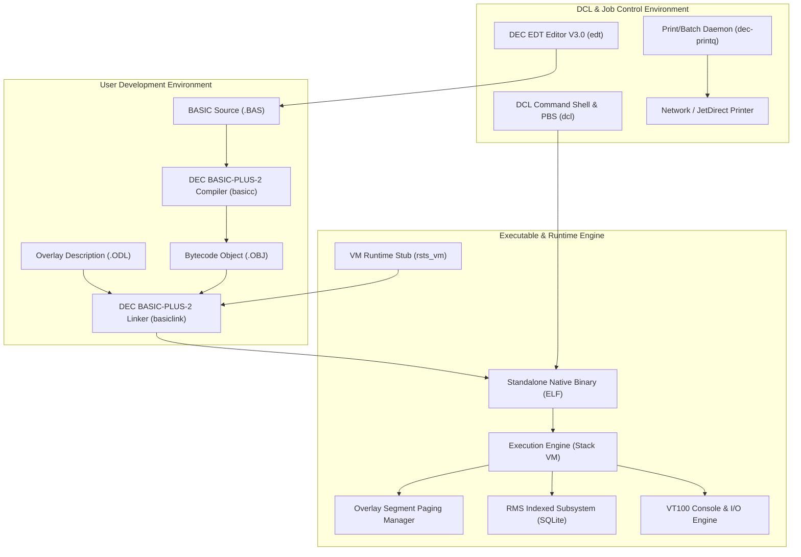
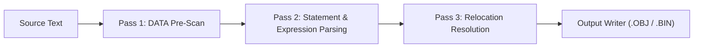

# DEC RSTS/E BASIC-PLUS-2 System Architecture & Implementation Manual

**Document Version**: 10.1-L  
**Target Platform**: Linux x86_64 / POSIX  
**Implementation Dialect**: Pure DEC BASIC-PLUS-2 & ANSI C Virtual Machine  

---

## 1. Architectural Overview

The DEC BASIC-PLUS-2 project provides a complete, modern reimplementation of the historic Digital Equipment Corporation (DEC) RSTS/E programming and execution environment for modern 64-bit Linux systems.

The subsystem comprises six tightly coupled layers:
1. **The Native Compiler (`compiler/basicc.bas` -> `compiler/basicc`)**: A multi-pass compiler written entirely in pure DEC BASIC-PLUS-2 that translates source programs into RSTS/E bytecode modules (`.obj` and `.bin`).
2. **The Native Linker (`linker/basiclink.bas` -> `linker/basiclink`)**: A link editor and overlay manager written entirely in pure DEC BASIC-PLUS-2 that resolves module symbols, parses Overlay Description Language (`.odl`) trees, and packages standalone ELF executables.
3. **The Bytecode Virtual Machine (`vm/` -> `vm/build/rsts_vm`)**: A high-performance, stack-based C runtime executing RSTS/E bytecode, supporting overlays, math, string manipulation, and system calls.
4. **The RMS Indexed File Engine (`vm/src/rms.c`)**: A Record Management Services implementation backed by SQLite, providing authentic DEC indexed file operations (`OPEN`, `GET`, `PUT`, `MAP`, `FIELD`).
5. **The DIGITAL Command Language Processor (`dcl/dcl.bas` -> `dcl/dcl`)**: A full DCL shell, batch script interpreter (`.COM`/`.DCL`), and Print/Batch Services (PBS) job controller.
6. **The DEC EDT Editor V3.0 (`edt/edt.bas` -> `edt/edt`)**: An authentic line-mode (`*`) and VT100 full-screen Change Mode text editor.



---

## 2. The Native Compiler (`compiler/basicc.bas`)

The compiler is implemented as a 1,730-line pure DEC BASIC-PLUS-2 program. It avoids external parsing frameworks at runtime, compiling directly from source text to structured bytecode.

### 2.1 Multi-Pass Pipeline



1. **Pass 1: DATA Pre-Scan**
   - Scans the entire source file prior to bytecode emission to collect all `DATA` statement literals.
   - Populates integer (`DATA_INT%`), string (`DATA_STR$`), and type (`DATA_TYPE%`) constant pools.
   - Emits the initial `OP_INIT_DATA` (0x76) bytecode block so constant data items are loaded into the VM's `g_data_pool` before statement execution commences.

2. **Pass 2: Statement Parsing & Bytecode Generation**
   - Processes lines sequentially, stripping comments (`!` and `REM`) and concatenating ampersand (`&`) continuation lines.
   - Maps line numbers and alphanumeric labels into `LINE_NUM%()`, `LINE_LBL$()`, and `LINE_OFF%()`.
   - Splits statements delimited by backslashes (`\`) outside of quotation marks.
   - Dispatches statements via structured alphanumeric subroutines (`STMT_PRINT`, `STMT_LET`, `STMT_IF`, `STMT_FOR`, `STMT_OPEN`, `STMT_MAP`, `STMT_CALL`, etc.).

3. **Pass 3: Relocation Resolution**
   - Traverses the relocation table (`REL_OFF%()`, `REL_TYPE$()`, `REL_TGT_NUM%()`, `REL_TGT_NAME$()`).
   - Resolves forward and backward jumps for numeric line numbers (`GOTO 100`) and alphanumeric labels (`GOTO CLEANUP:`) into 16-bit little-endian relative bytecode offsets.
   - Unresolved external references (e.g., `CALL "FUNC1"`) are preserved in the relocation table as `CALL_OVL` relocations for the linker.

### 2.2 Expression Parsing & Operator Precedence

The compiler implements a recursive-descent expression parser with an explicit operand stack (`STK_OP$()`, `STK_REXP$()`) to prevent variable clobbering during nested recursion in BASIC:

| Precedence | Operator / Construct | Opcode Emitted |
|:---|:---|:---|
| 1 (Lowest) | `OR` | `OP_OR` (0x29) |
| 2 | `AND` | `OP_AND` (0x28) |
| 3 | `=`, `<>`, `<`, `>`, `<=`, `>=` | `OP_EQ` (0x30) .. `OP_GE` (0x35) |
| 4 | `+`, `-` (Addition, Subtraction, String Concatenation) | `OP_ADD` (0x20), `OP_SUB` (0x21) |
| 5 | `*`, `/` (Multiplication, Division) | `OP_MUL` (0x22), `OP_DIV` (0x23) |
| 6 | Unary `-` | `OP_NEG` (0x24) |
| 7 (Highest)| Built-in Functions, Subscripts, Constants, Variables | Subroutine dispatch / Value Push |

### 2.3 Variable and Memory Model
- **Integers**: Suffix `%` (e.g., `COUNT%`, `P%`). Handled as 32-bit signed integers.
- **Strings**: Suffix `$` (e.g., `NAME$`, `L$`). Dynamically sized character buffers.
- **Floats**: No suffix (e.g., `BALANCE`, `X`). Handled as 32-bit single-precision floats.
- **Arrays**: Explicitly declared via `DIM ARR%(size%)`. Array element access emits `OP_LOAD_A` (0x15) and `OP_STORE_A` (0x16).
- **MAP Buffers**: `MAP (NAME) VAR1$, VAR2%, ...` binds memory variables to an RMS record buffer.

---

## 3. The Native Linker (`linker/basiclink.bas`)

The linker resolves independently compiled object modules and builds standalone native ELF executables.

### 3.1 Object File Format (`.obj`)
Each `.obj` file is a JSON-encoded object module containing:
- `module`: Module name (e.g., `"MAIN"`, `"FUNC1"`).
- `symbols`: Exported entry points (`name`, `type`, `offset`).
- `relocations`: External overlay calls (`type: "CALL_OVL"`, `offset`, `target`).
- `bytecode`: Array of decimal bytecode integers.

### 3.2 ODL Overlay Tree Layout
The linker parses Overlay Description Language (`.odl`) files:
```odl
.ROOT MAIN-O1
O1: .FCTR FUNC1,FUNC2
.END
```
1. Parses `.ROOT` and `.FCTR` definitions.
2. Identifies the root segment (loaded at virtual address 0) and overlay segments sharing virtual memory windows.
3. Computes each segment's virtual address (`SEG_VADDR%()`), segment length (`SEG_LEN%()`), and global bytecode pool offset (`SEG_START%()`).
4. Patches all `CALL_OVL` relocations in every segment with the 16-bit target segment index.

### 3.3 Executable Packaging
The linker packages the application directly into a standalone Linux executable:
1. Copies the pre-compiled C VM runtime (`vm/build/rsts_vm`) to the target executable path.
2. Appends the binary RSTS/E payload:
   - 2 bytes: Segment count (`num_segments`).
   - For each segment: 16 bytes module name (null-padded) + 4 bytes size + 4 bytes virtual address.
   - Raw concatenated bytecode pool for all segments.
   - 4 bytes magic signature: `"RSTS"` (`0x52535453`).
   - 4 bytes payload size (little-endian).
3. Sets executable permissions (`chmod 755`).

When the resulting binary executes, the C runtime inspects its own file trailer, detects the `"RSTS"` magic signature, extracts the segment table, and immediately begins executing Segment 0 (Root).

---

## 4. Virtual Machine Opcode Specification

The VM implements a stack-based architecture with 256 value registers and a dedicated call stack for `GOSUB`/`RETURN`.

### Complete Opcode Reference Table

| Hex | Opcode Name | Operands | Stack Effect | Description |
|:---|:---|:---|:---|:---|
| `0x00` | `OP_HALT` | - | - | Terminates execution of the root program |
| `0x10` | `OP_PUSH_INT` | `val: int16` | `-> [int]` | Pushes 16-bit integer constant |
| `0x11` | `OP_PUSH_FLOAT` | `val: float32` | `-> [float]` | Pushes 32-bit floating-point constant |
| `0x12` | `OP_PUSH_STR` | `len: uint8, bytes` | `-> [str]` | Pushes string literal |
| `0x13` | `OP_LOAD_VAR` | `var_idx: uint16` | `-> [val]` | Loads variable value onto stack |
| `0x14` | `OP_STORE_VAR` | `var_idx: uint16` | `[val] ->` | Stores stack top into variable |
| `0x15` | `OP_LOAD_A` | `var_idx: uint16` | `[idx] -> [val]` | Loads array element `arr[idx]` |
| `0x16` | `OP_STORE_A` | `var_idx: uint16` | `[val, idx] ->` | Stores `val` into `arr[idx]` |
| `0x17` | `OP_DIM` | `var_idx: uint16, sz: uint16` | - | Allocates array of specified size |
| `0x20` | `OP_ADD` | - | `[b, a] -> [a + b]` | Arithmetic addition or string concatenation |
| `0x21` | `OP_SUB` | - | `[b, a] -> [a - b]` | Arithmetic subtraction |
| `0x22` | `OP_MUL` | - | `[b, a] -> [a * b]` | Arithmetic multiplication |
| `0x23` | `OP_DIV` | - | `[b, a] -> [a / b]` | Arithmetic division |
| `0x24` | `OP_NEG` | - | `[a] -> [-a]` | Unary arithmetic negation |
| `0x28` | `OP_AND` | - | `[b, a] -> [a AND b]` | Bitwise integer AND or logical AND |
| `0x29` | `OP_OR` | - | `[b, a] -> [a OR b]` | Bitwise integer OR or logical OR |
| `0x30` | `OP_EQ` | - | `[b, a] -> [a == b]` | Relational test for equality |
| `0x31` | `OP_NE` | - | `[b, a] -> [a != b]` | Relational test for inequality |
| `0x32` | `OP_LT` | - | `[b, a] -> [a < b]` | Relational test for less than |
| `0x33` | `OP_GT` | - | `[b, a] -> [a > b]` | Relational test for greater than |
| `0x34` | `OP_LE` | - | `[b, a] -> [a <= b]` | Relational test for less than or equal |
| `0x35` | `OP_GE` | - | `[b, a] -> [a >= b]` | Relational test for greater than or equal |
| `0x40` | `OP_JMP` | `target: uint16` | - | Unconditional jump to bytecode target |
| `0x41` | `OP_RET` | - | - | Returns from subroutine or overlay segment |
| `0x42` | `OP_CALL_OVL` | `seg_idx: uint16` | - | Executes overlay segment |
| `0x43` | `OP_CALL` | `target: uint16` | - | Subroutine call (`GOSUB`), pushes return PC |
| `0x44` | `OP_JMP_IF_FALSE`| `target: uint16` | `[cond] ->` | Conditional jump if condition is false (0) |
| `0x50` | `OP_PRINT` | - | `[val] ->` | Outputs value followed by newline |
| `0x52` | `OP_PRINT_NO_NL` | - | `[val] ->` | Outputs value without trailing newline |
| `0x53` | `OP_PRINT_USING` | `fmt_idx: uint16` | `[val] ->` | Formats output using DEC `PRINT USING` template |
| `0x60` | `OP_OPEN` | `ch: uint8, mode: uint8` | `[fname] ->` | Opens file channel (Sequential or Indexed) |
| `0x61` | `OP_CLOSE` | `ch: uint8` | - | Flushes and closes file channel |
| `0x62` | `OP_GET` | `ch: uint8` | `[key] ->` | Retrieves record by key or sequential cursor |
| `0x63` | `OP_PUT` | `ch: uint8` | - | Inserts or updates record from MAP buffer |
| `0x64` | `OP_FIELD` | `ch: uint8, ...` | - | Defines sequential file record field offsets |
| `0x65` | `OP_MAP` | `map_id: uint8, ...` | - | Binds variables to channel buffer |
| `0x67` | `OP_RESUME` | `target: uint16` | - | Resumes execution after error trap |
| `0x70` | `OP_INPUT_I` | `var_idx: uint16` | - | Reads integer from console input |
| `0x71` | `OP_INPUT_S` | `var_idx: uint16` | - | Reads string from console input |
| `0x72` | `OP_INPUT_PROMPT`| `len: uint8, bytes` | - | Displays prompt string for `INPUT` |
| `0x73` | `OP_INPUT_LINE` | `var_idx: uint16` | - | Reads entire raw line from console |
| `0x74` | `OP_GETCH` | `var_idx: uint16` | - | Non-blocking console read (`INKEY$`) |
| `0x76` | `OP_INIT_DATA` | `cnt: uint16, items` | - | Initializes `DATA` constant items |
| `0x77` | `OP_READ` | `var_idx: uint16` | - | Reads next constant item into variable |
| `0x78` | `OP_RESTORE` | - | - | Resets `DATA` read pointer to beginning |
| `0x7B` | `OP_INPUT_LINE_CH`| `ch: uint8, idx: uint16`| - | Reads line from file channel into variable |
| `0x7C` | `OP_LEN` | - | `[str] -> [len]` | Computes string character length |
| `0x7D` | `OP_MID` | - | `[len, pos, str] -> [sub]`| Substring extraction `MID$(S$, pos, len)` |
| `0x7E` | `OP_LEFT` | - | `[len, str] -> [sub]` | Left substring extraction `LEFT$(S$, len)` |
| `0x7F` | `OP_RIGHT` | - | `[pos, str] -> [sub]` | DEC right substring from index `RIGHT$(S$, pos)` |
| `0x80` | `OP_INSTR` | - | `[target, str, pos] -> [idx]`| Substring search `INSTR(pos, str, target)` |
| `0x81` | `OP_VAL` | - | `[str] -> [num]` | Converts string literal to numeric value |
| `0x82` | `OP_STR` | - | `[num] -> [str]` | Converts numeric value to string |
| `0x83` | `OP_ASCII` | - | `[str] -> [code]` | Returns ASCII value of first character |
| `0x84` | `OP_SYS` | - | `[cmd] -> [rc]` | Executes host shell command via POSIX `system()` |
| `0x85` | `OP_COMMAND_STR` | - | `-> [args]` | Pushes command line string `COMMAND$` |
| `0x86` | `OP_TIME_STR` | - | `-> [time]` | Pushes current system time string `TIME$` |

---

## 5. Record Management Services (RMS) Subsystem

DEC RMS-11 provided indexed and sequential file storage for PDP-11 applications. Our runtime maps RMS operations directly onto an embedded SQLite database engine, preserving exact BASIC-PLUS-2 semantics while offering modern performance and durability.

### 5.1 Storage Architecture
- When a file is opened as `ORGANIZATION INDEXED` (e.g., `SALES.IDX`):
  - SQLite creates a table matching the record layout.
  - Primary keys (`PRIMARY KEY`) and alternate keys (`ALTERNATE KEY`) are mapped to SQLite indexed columns with `B-TREE` backing.
- `MAP (NAME) VAR1$, VAR2%, ...` statements establish memory offsets into the record buffer.
- `PUT #ch` serializes the active MAP variables into an SQL `INSERT OR REPLACE` query.
- `GET #ch, KEY #0% = key_val` executes an indexed SQL `SELECT`, binding the retrieved columns directly back into the MAP variables.
- Sequential `GET #ch` traverses the active cursor. When the last record is read, the VM raises error 11 (`ERR = 11%`, `End of File`), which triggers the application's `ON ERROR GOTO` handler.

---

## 6. DIGITAL Command Language (DCL) & PBS Subsystem

The DCL processor (`dcl/dcl.bas`) provides the classic RSTS/E system interface:
- **Command Parsing**: Identifies verbs (`SHOW`, `PRINT`, `SUBMIT`, `BASIC`, `LINK`, `RUN`, `TYPE`, `DIRECTORY`) and attached qualifiers (`/QUEUE=`, `/COPIES=`, `/NAME=`, `/DELETE`).
- **Command Procedures**: Interprets `@procedure.com` and `@procedure.dcl` batch scripts with labels, `IF...THEN GOTO` branching, and `'SYMBOL'` interpolation.
- **Print/Batch Services (PBS)**: Manages background job queues backed by SQLite:
  - `PRINT`: Spools files to print queues (`LP0:`, `NETPRINT`).
  - `SUBMIT`: Submits procedures to batch processing (`SYS$BATCH`).
  - `SHOW QUEUE`, `SHOW JOBS`, `SHOW ENTRY`, `DELETE/ENTRY`: Comprehensive queue administration.
- **Print Symbiont (`dec-printq`)**: Background daemon rendering authentic DEC 5x5 ASCII block letter burst/banner pages and dispatching print jobs directly to CUPS or raw TCP socket network printers (JetDirect port 9100).

---

## 7. DEC EDT Editor V3.0

The text editor (`edt/edt.bas`) provides:
- **Line Mode**: Authentic `*` prompt commands:
  - `INSERT` (`I`), `DELETE` (`D`), `TYPE` (`T`), `REPLACE` (`R`), `FIND` (`F`), `SUBSTITUTE` (`S`), `RESEQUENCE` (`RESEQ`), `SHOW`, `WRITE`, `EXIT`, `QUIT`, `HELP`.
- **Change Mode**: Full-screen VT100 video terminal mode using ANSI escape sequences:
  - Cursor navigation, live text windowing, status line display (`[EDT] BUFFER: MAIN LINE: n`).
- **Keypad & Macros**:
  - `DEFINE KEY` and `DEFINE MACRO` commands.
  - Startup initialization file auto-loading (`EDTINI.EDT`).
  - Command script execution (`@macro.edt`).
