# DEC PDP-11 RSTS/E V10.1-L — Third-Party Commercial & Business Applications Planning Document

## 1. Overview & Historical Context
During the 1970s and 1980s, **DEC PDP-11 RSTS/E (Resource-Sharing Timesharing System/Extended)** powered thousands of corporate, banking, manufacturing, wholesale distribution, and university data-processing centers. While Digital Equipment Corporation supplied core layered products (`DATATRIEVE-11`, `DECword/DP`, `DECmail-11`, `DECgraph`, `FMS-11`, `SORT-11`, `RMS-11`, and `DIBS-11`), the majority of commercial application software running on RSTS/E was authored and distributed by **Independent Software Vendors (ISVs)**, **Commercial OEMs**, and **DECUS** contributors cataloged in the *DEC PDP-11 Software Source Book*.

With all **7 native RSTS/E compilers** now available in `LANG/` and integrated into `OS/RSTS-E/` (`BASIC-PLUS-2`, `MACRO-11`, `COBOL-81`, `FORTRAN-77`, `DIBOL-83`, `RPG II`, and `APL-11`), we can authentically implement these third-party commercial packages in the exact languages in which they were historically written.

---

## 2. Candidate Third-Party RSTS/E Business Applications Catalog

```mermaid
flowchart TD
    RSTSE["DEC PDP-11 RSTS/E V10.1-L Executive & CCL"]
    RSTSE --> OA["1. Office Automation & Word Processing"]
    RSTSE --> SS["2. Spreadsheets & Financial Modeling"]
    RSTSE --> ERP["3. ERP, Accounting & Manufacturing"]
    RSTSE --> DBMS["4. Third-Party DBMS & 4GLs"]
    RSTSE --> EGH["5. Data Entry, Transaction & System Tools"]
    RSTSE --> STAT["6. Statistical & Decision Support"]

    OA --> WORD11["WORD-11 (Data Processing Design)"]
    OA --> LEX11["LEX-11 (EEC Systems)"]
    OA --> SATWP["Saturn-WP (Saturn Systems)"]

    SS --> A2020["20/20 Spreadsheet (Access Technology)"]
    SS --> SATCALC["Saturn-Calc (Saturn Systems)"]
    SS --> NYPLAN["NYPLAN Financial Modeling (Nyplan Inc.)"]

    ERP --> MCBA["MCBA ERP & MRP Suite (MCBA Inc.)"]
    ERP --> MAPS["MAPS Accounting & Planning (Ross Systems)"]
    ERP --> TIMELINE["Timeline DIGI-GL & Financials (Timeline Inc.)"]
    ERP --> CAS["Compu-Share CAS Accounting (Compu-Share)"]
    ERP --> CJ["CJ/BUSINESS Suite (Collier-Jackson)"]

    DBMS --> TOTAL["TOTAL Network DBMS (Cincom Systems)"]
    DBMS --> AMBASE["AMBASE / AMWRITER (Amcor Computer)"]
    DBMS --> ACCENTR["ACCENT R 4GL/RDBMS (NIS)"]
    DBMS --> SATBASE["Saturn-Base (Saturn Systems)"]

    EGH --> KDSS["KDSS Key-to-Disk Data Entry (EG&H)"]
    EGH --> TAM["TAM Terminal Application Manager (EG&H)"]
    EGH --> FSORT3["FSORT3 & VSELECT (EG&H)"]
    EGH --> CONTRL["CONTRL / AUDIT Security Suite (Clyde Digital)"]

    STAT --> MINITAB["MINITAB Worksheet (Minitab / Penn State)"]
    STAT --> SPSS11["SPSS-11 Statistical Suite (SPSS Inc.)"]
```

---

## 3. Detailed Specifications by Category

### Category A: Office Automation & Word Processing (COMPLETED)

| Package | Status | Original Vendor | Historical Era | Primary Language | CCL Verb(s) | Core Capabilities Emulated |
| :--- | :---: | :--- | :---: | :---: | :---: | :--- |
| **`word11`** (*WORD-11 V3.1*) | **Done** (`APPS/apps/word11`) | Data Processing Design, Inc. (DPD) | 1977–1990 | `BASIC-PLUS-2` | `WORD11`, `W11` | Multi-user VT100 keypad word processor (`GOLD` key map), document library index (`W11DOC.DAT`), ruler-based margins/tabs, list processing (`LPLIST`/`LPADD`/`MERGE`), spelling dictionary check (`SPELL`/`DICTADD`), pagination, and background `LP0:` spooling (`SPOOL`). |
| **`lex11`** (*LEX-11 V2.4*) | **Done** (`APPS/apps/lex11`) | EEC Systems, Inc. | 1979–1989 | `BASIC-PLUS-2` | `LEX11`, `LEX` | Menu-driven & command-driven office automation suite (`LEXDOC.DAT`) with integrated desk calculator (`CALC`), form-letter mass mailer (`MAILLIST`/`MAILADD`/`MERGE`), glossary abbreviations (`GLOSSARY`/`GLOSSADD`/`EXPAND`), and ruler formatting. |
| **`saturnwp`** (*Saturn-WP V4.2*) | **Done** (`APPS/apps/saturnwp`) | Saturn Systems, Inc. | 1981–1989 | `BASIC-PLUS-2` | `SATURNWP`, `SWP` | Integrated word processor (`SATWP.DAT`) capable of importing live spreadsheet ranges from `Saturn-Calc` (`CALCTABLE`/`CALCSET`/`EMBEDCALC`) and database records from `Saturn-Base` (`BASELIST`/`BASEADD`/`MERGE`). |

---

### Category B: Electronic Spreadsheets & Corporate Financial Modeling (COMPLETED)

| Package | Status | Original Vendor | Historical Era | Primary Language | CCL Verb(s) | Core Capabilities Emulated |
| :--- | :---: | :--- | :---: | :---: | :--- | :--- |
| **`calc2020`** (*20/20 V2.3* / *Supercomp-20*) | **Done** (`APPS/apps/calc2020`) | Access Technology, Inc. | 1981–1992 | `BASIC-PLUS-2` | `CALC2020`, `2020`, `SC20` | Industry-standard minicomputer spreadsheet: 2D grid (`A1..D8`), `/` slash command bar (`/W`, `/C`, `/F`, `/P`, `/G`, `/M`, `/S`), formula evaluator (`@SUM`, `@AVG`, `@NPV`, `@IRR`, `@IF`, `@LOOKUP`), goal-seeking (`GOALSEEK`), multi-sheet consolidation (`CONSOLIDATE`), and RMS/DATATRIEVE `SC20WS.DAT` import/export. |
| **`saturncalc`** (*Saturn-Calc V3.4*) | **Done** (`APPS/apps/saturncalc`) | Saturn Systems, Inc. | 1982–1990 | `BASIC-PLUS-2` | `SATURNCALC`, `SATCALC`, `SCALC` | Virtual-array backed VT100 electronic worksheet (`SCALC.DAT`) with split-window dual pane views (`SPLIT`), financial depreciation (`@SLN`, `@DDB`, `@SYD`) & loan amortization (`@PMT`), and direct handoff to `Saturn-Graph` (`GRAPH`) and `Saturn-WP` (`EXPORTWP` / `SCALC.WKS`). |
| **`nyplan`** (*NYPLAN V4.1*) | **Done** (`APPS/apps/nyplan`) | Nyplan, Inc. | 1978–1988 | `BASIC-PLUS-2` | `NYPLAN`, `NYP` | Corporate financial modeling, budgeting, "what-if" sensitivity analysis (`WHATIF`), Monte Carlo variance runs (`MONTECARLO`), and multi-division P&L consolidation (`CONSOLIDATE`) with `NYPLAN.DAT` persistence. |

---

### Category C: ERP, Accounting, Wholesale Distribution & MRP (COMPLETED)

| Package | Status | Original Vendor | Historical Era | Primary Language | CCL Verb(s) | Core Capabilities Emulated |
| :--- | :---: | :--- | :---: | :---: | :---: | :--- |
| **`mcba`** (*MCBA V7.2 ERP & MRP*) | **Done** (`APPS/apps/mcba`) | Mini-Computer Business Applications, Inc. (MCBA) | 1975–1992 | `BASIC-PLUS-2` | `MCBA`, `MCBAMRP` | Modular ERP & Manufacturing suite (`MCBAIM.DAT`): Customer Order Processing (`COP`), Inventory Management (`I/M`), Bill of Material Processor (`BOMP`), Material Requirements Planning (`MRP`), Shop Floor Control (`SFC`), and `GL`. |
| **`maps`** (*MAPS V5.0*) | **Done** (`APPS/apps/maps`) | Ross Systems, Inc. | 1976–1990 | `BASIC-PLUS-2` | `MAPS`, `MAPSGL` | Management Accounting and Planning System (`MAPSGL.DAT`): hierarchical responsibility-center accounting (`ROLLUP`), budget vs. actual variance reporting (`VARIANCE`), and `MAPS/MODEL` forecasting (`FORECAST`). |
| **`timeline`** (*Timeline DIGI-GL V4.3*) | **Done** (`APPS/apps/timeline`) | Timeline, Inc. | 1977–1989 | `BASIC-PLUS-2` | `TIMELINE`, `DIGIGL` | Multi-segmented Chart of Accounts engine (`DIGIGL.DAT`), trial balance verification (`TRIAL`), segment filter (`SEGMENT`), and financial statement writer (`FINRPT`). |
| **`compushare`** (*CAS V6.1*) | **Done** (`APPS/apps/compushare`) | Compu-Share, Inc. | 1978–1989 | `BASIC-PLUS-2` | `COMPUSHARE`, `CAS` | Commercial Accounting System (`CASJIB.DAT`): Division of Interest (`DOI`), Joint-Interest Billing (`JIB`), Net Revenue Interest (`REVDIST`), and AFE capital tracking (`AFE`). |
| **`cjbusiness`** (*CJ/BUSINESS V5.4*) | **Done** (`APPS/apps/cjbusiness`) | Collier-Jackson, Inc. | 1977–1989 | `BASIC-PLUS-2` | `CJBUSINESS`, `CJBIZ`, `CJGL` | Enterprise general ledger (`CJGL`), human resources/payroll register (`CJPAY`), and newspaper circulation/advertising billing (`CJCIRC`) with `CJBIZ.DAT` persistence. |

---

### Category D: Third-Party Database Management Systems (DBMS) & 4GLs (COMPLETED)

| Package | Status | Original Vendor | Historical Era | Primary Language | CCL Verb(s) | Core Capabilities Emulated |
| :--- | :---: | :--- | :---: | :---: | :---: | :--- |
| **`total`** (*CINCOM TOTAL V8.0*) | **Done** (`APPS/apps/total`) | Cincom Systems, Inc. | 1974–1988 | `BASIC-PLUS-2` | `TOTAL`, `TOTDBM` | Network-model DBMS (`TOTDB.DAT`) distinguishing **Master Data Sets** (`READM`, `ADDM`) and **Variable Entry Data Sets** (`READV`, `ADDV`, `FINDX`), with `DBGEN` DDL compiler (`SCHEMA`) and `SINON`. |
| **`ambase`** (*AMBASE V4.2*) | **Done** (`APPS/apps/ambase`) | Amcor Computer Corp. | 1977–1989 | `BASIC-PLUS-2` | `AMBASE`, `AMQRY`, `AMWRITER` | RSTS/E indexed database engine (`AMBASE.DAT`) with `SCHEMA`, interactive query (`AMQUERY`), `AMWRITER` ad-hoc report generator, and `AMGEN` screen builder. |
| **`accentr`** (*ACCENT R V11.4*) | **Done** (`APPS/apps/accentr`) | National Information Systems (NIS) | 1979–1990 | `BASIC-PLUS-2` | `ACCENTR`, `ACCENT`, `ACCR` | Structured Fourth-Generation Language (4GL) and RDBMS (`ACCRDB.DAT`): Data Set Definition (`DSD`), Data Set (`DS`), Process Module (`PM`), Command Module (`CM`), and `EXTRACT`. |
| **`saturnbase`** (*Saturn-Base V3.2*) | **Done** (`APPS/apps/saturnbase`) | Saturn Systems, Inc. | 1982–1989 | `BASIC-PLUS-2` | `SATURNBASE`, `SATBASE`, `SBASE` | Interactive relational data manager (`SBASE.DAT`) with `SCHEMA`, `SELECT`, `SORT`, `REPORT`, and direct export handoff to `Saturn-Calc` (`EXPORTCALC`) and `Saturn-WP` (`EXPORTWP`). |

---

### Category E: Data Entry, Sorting, Screen Managers & Security Utilities (COMPLETED)

| Package | Status | Original Vendor | Historical Era | Primary Language | CCL Verb(s) | Core Capabilities Emulated |
| :--- | :---: | :--- | :---: | :---: | :---: | :--- |
| **`kdss`** (*KDSS V4.0*) | **Done** (`APPS/apps/kdss`) | Evans Griffiths & Hart, Inc. (EG&H) | 1976–1989 | `BASIC-PLUS-2` | `KDSS`, `KDFMT`, `KDENT` | High-speed multi-operator key-to-disk subsystem (`KDBAT.DAT`): format definition (`KDFMT`), batch entry (`KDENT`), key-verification pass (`KDVER`), Modulo-10 check-digit validation (`CHECKDIGIT`), operator stats (`STATS`), and RMS release (`RELEASE`). |
| **`tam`** (*TAM V3.2*) | **Done** (`APPS/apps/tam`) | Evans Griffiths & Hart, Inc. (EG&H) | 1978–1989 | `BASIC-PLUS-2` | `TAM` | VT100 screen-painting (`RENDER`), field-attribute validation (`VALIDATE`), and transaction monitor (`TAMFRM.DAT`) for RSTS/E commercial applications. |
| **`fsort3`** (*FSORT3 & VSELECT V3.5*) | **Done** (`APPS/apps/fsort3`) | Evans Griffiths & Hart, Inc. (EG&H) | 1977–1989 | `BASIC-PLUS-2` | `FSORT3`, `VSELECT` | High-speed multi-key record sorting (`SORT ASC`/`SORT DESC`) and boolean record selection/projection (`VSELECT`) on `FSORT.DAT` files. |
| **`clyde`** (*CONTRL / AUDIT / LOCK V4.1*) | **Done** (`APPS/apps/clyde`) | Clyde Digital Systems | 1979–1990 | `BASIC-PLUS-2` | `CLYDE`, `CONTRL`, `CAUDIT` | RSTS/E terminal security suite (`CAUDIT.DAT`): `TERMINALS` monitor, live `CONTRL` session mirror (`OBSERVE`), `CAUDIT` keystroke audit trail (`AUDIT`), and Intruder `LOCK` / `UNLOCK`. |

---

### Category F: Statistical & Decision Support Systems (COMPLETED)

| Package | Status | Original Vendor | Historical Era | Primary Language | CCL Verb(s) | Core Capabilities Emulated |
| :--- | :---: | :--- | :---: | :---: | :---: | :--- |
| **`minitab`** (*MINITAB-11 V82.1*) | **Done** (`APPS/apps/minitab`) | Minitab, Inc. / Penn State | 1975–1990 | `BASIC-PLUS-2` | `MINITAB`, `MTAB` | Interactive statistical worksheet (`MTABWS.DAT`, columns `C1..C3`) with `PRINT`, `DESCRIBE`, `HISTOGRAM`, `PLOT`, least-squares linear `REGRESS`, and `TTEST`. |
| **`spss11`** (*SPSS-11 V9.0*) | **Done** (`APPS/apps/spss11`) | SPSS, Inc. | 1977–1988 | `BASIC-PLUS-2` | `SPSS11`, `SPSS` | PDP-11 RSTS/E statistical package (`SPSS11.DAT`) supporting `DATALIST`, `FREQUENCIES`, `CONDESCRIPTIVE`, `CROSSTABS` (with Chi-Square), One-Way `ANOVA`, and `PEARSON` correlation. |

---

## 4. Recommended Implementation Architecture & Phased Roadmap

To preserve full compatibility with our existing `APPS/` and `OS/RSTS-E/` architecture:
1. **Multi-Language Authenticity**:
   - Build **MCBA** in `DIBOL-83` (`dibol83`) or `COBOL-81` (`cobol81`).
   - Build **MINITAB-11** and **SPSS-11** in `FORTRAN-77` (`fortran77`).
   - Build **FSORT3 / VSELECT** or low-level modules in `MACRO-11` (`macro11`).
   - Build **20/20**, **WORD-11**, **LEX-11**, **Saturn Suite**, **CINCOM TOTAL**, **Timeline G/L**, and **EG&H KDSS** in `BASIC-PLUS-2` (`basicc`).
2. **RAD-50 6.3 Filename & `.OBJ`/`.TSK` Compliance**:
   - All RSTS/E data files and task images strictly follow 6.3 uppercase naming (`W11DOC.DAT`, `SC20WS.DAT`, `MCBAIM.DAT`, `TOTMDB.DAT`) and compile to `.OBJ` -> `.TSK` executables staged into `OS/RSTS-E/system/bin/`.
3. **Suggested Phased Rollout**:
   - **Phase 1 — Flagship Third-Party Office & Spreadsheet Suite**:
     1. **`word11`** (*DPD WORD-11* Word Processor)
     2. **`calc2020`** (*Access Technology 20/20* Electronic Spreadsheet)
     3. **`saturn`** (*Saturn-Calc / Saturn-WP / Saturn-Base* Integrated Office Suite)
   - **Phase 2 — Flagship Third-Party ERP, MRP & DBMS**:
     4. **`mcba`** (*MCBA Manufacturing & Distribution ERP*: `COP`, `I/M`, `BOMP`, `MRP`)
     5. **`timeline`** (*Timeline DIGI-GL* Multi-Segmented General Ledger & Financial Report Writer)
     6. **`total`** (*Cincom TOTAL* Network-Model DBMS)
   - **Phase 3 — Data Entry, Security & Statistical Decision Support**:
     7. **`kdss`** (*Evans Griffiths & Hart KDSS* Key-to-Disk Data Entry & Verification)
     8. **`fsort3`** (*Evans Griffiths & Hart FSORT3 & VSELECT*)
     9. **`minitab`** (*MINITAB-11* Interactive Statistical Worksheet in FORTRAN-77)
     10. **`spss11`** (*SPSS-11* Statistical Package in FORTRAN-77)
