# DEC VAX/VMS V5.5-2 — Third-Party Commercial, Scientific & Enterprise Applications Planning Document

## 1. Overview & Historical Context

Throughout the 1980s and early 1990s, **32-bit DEC VAX/VMS (Virtual Memory System)** — spanning the `VAX-11/780`, `MicroVAX II`, `VAX 8600/8800`, `VAX 6000/9000`, and `VAXstation 3100/4000` series — was the dominant minicomputer and technical workstation platform in Fortune 500 enterprises, Wall Street financial institutions, aerospace & semiconductor engineering, pharmaceutical research, hospital laboratories, and universities.

Through Digital Equipment Corporation's **Cooperative Marketing Program (CMP)**, **System Cooperative Marketing Program (SCMP)**, and the multi-volume *DEC VAX Software Source Book*, thousands of Independent Software Vendors (ISVs) delivered commercial and scientific packages built atop VAX/VMS's signature architectural strengths:
- **32-bit flat virtual address space** (`4 GB` virtual addressing, `PAGEFILE.SYS` demand paging, and large working sets)
- **VAX Record Management Services (`RMS`)** and **VAX Common Language Environment**
- **VT220/VT320 character-cell terminals** and **DECwindows X11 / OSF/Motif 1.1 (`WSA0:`)** graphical workstations

This document catalogs both:
1. **Cross-Platform PDP-11 / VAX Commercial Packages (21 Applications — Already Implemented in `APPS/apps/`)** that migrated from PDP-11 RSTS/E to VAX/VMS (`WORD-11`, `LEX-11`, `20/20`, `Saturn Suite`, `MCBA`, `Ross MAPS`, `Timeline`, `Compu-Share`, `Collier-Jackson`, `Cincom TOTAL`, `AMBASE`, `ACCENT R`, `EG&H KDSS/TAM/FSORT3`, `Clyde Security`, `MINITAB`, and `SPSS`), ready to be staged into `OS/VMS/`.
2. **New 32-bit VAX/VMS-Native Flagship Third-Party Applications (18 Applications across 7 Categories)** representing the iconic software packages that ran on 32-bit VAX/VMS (`WordPerfect`, `Interleaf`, `Lotus 1-2-3`, `IFPS`, `Oracle V6`, `INGRES`, `FOCUS`, `Cognos PowerHouse`, `System 1032`, `ASK MANMAN`, `Cerner PathNet`, `SAS`, `BBN RS/1`, `SPICE3`, `ANSYS`, `Gaussian`, `Diskeeper`, and `RoboMon`).

---

## 2. Third-Party VAX/VMS Application Ecosystem Architecture

```mermaid
flowchart TD
    VAXVMS["DEC VAX/VMS V5.5-2 Executive, DCL & DECwindows (WSA0:)"]
    VAXVMS --> OA["1. OA: Office Automation & Technical Publishing"]
    VAXVMS --> SS["2. SS: Spreadsheets, EIS & Financial Modeling"]
    VAXVMS --> DBMS["3. DBMS: Relational Databases & 4GLs"]
    VAXVMS --> ERP["4. ERP: MRP II, Accounting & Healthcare LIS"]
    VAXVMS --> STAT["5. STAT: Statistical, Lab Notebook & Matrix Systems"]
    VAXVMS --> CAD["6. CAD/CAE: Circuit, FEA & Computational Chemistry"]
    VAXVMS --> SYS["7. SYS: Disk Defragmentation, Security & Ops"]

    OA --> WP51["WordPerfect 5.1 for VAX/VMS (WordPerfect Corp.)"]
    OA --> ILEAF["Interleaf TPS Publishing (Interleaf Inc.)"]
    OA --> SHARED_OA["Ported Suites: WORD-11, LEX-11, Saturn-WP"]

    SS --> LOTUS["Lotus 1-2-3 for VAX/VMS (Lotus Development)"]
    SS --> IFPS["IFPS Financial Modeling (Execucom)"]
    SS --> SYSTEMW["System W Multidimensional DSS (Comshare)"]
    SS --> SHARED_SS["Ported Suites: 20/20, Saturn-Calc, NYPLAN"]

    DBMS --> ORACLE["Oracle V6 RDBMS + SQL*Plus/Forms (Oracle Corp.)"]
    DBMS --> INGRES["INGRES V6.2 RDBMS + QUEL/ABF (RTI)"]
    DBMS --> FOCUS["FOCUS 4GL & Reporting (Information Builders)"]
    DBMS --> PHOUSE["PowerHouse 4GL: QUICK/QUIZ/QTP (Cognos)"]
    DBMS --> S1032["System 1032 Bitmap 4GL/DBMS (Software House)"]
    DBMS --> SHARED_DB["Ported Suites: TOTAL, AMBASE, ACCENT R, Saturn-Base"]

    ERP --> MANMAN["ASK MANMAN MRP II Suite (ASK Computer Systems)"]
    ERP --> MAXCIM["NCA MAXCIM Factory MRP II (NCA Corp.)"]
    ERP --> CERNER["Cerner PathNet Clinical LIS (Cerner Corp.)"]
    ERP --> SHARED_ERP["Ported Suites: MCBA, Ross MAPS, Timeline, CAS, CJ/BIZ"]

    STAT --> SAS["SAS V6.06 DATA Step & PROCs (SAS Institute)"]
    STAT --> RS1["BBN RS/1 Lab Notebook (Bolt Beranek & Newman)"]
    STAT --> SHARED_ST["Ported Suites: MINITAB, SPSS-X"]

    CAD --> SPICE["VAX SPICE3 / HSPICE Simulator (UC Berkeley / Meta)"]
    CAD --> ANSYS["ANSYS V4.4 Finite Element Analysis (Swanson Analysis)"]
    CAD --> GAUSS["Gaussian 90 Quantum Chemistry (Gaussian Inc.)"]

    SYS --> DISKEEP["DISKEEPER V4.0 Online Defragmenter (Executive SW)"]
    SYS --> ROBOMON["RoboMon Rule-Based Operations Monitor (Heroix)"]
    SYS --> SHARED_SYS["Ported Suites: Clyde CONTRL/AUDIT, EG&H KDSS/TAM/FSORT3"]
```

---

## 3. Cross-Platform Commercial Packages Already Built in `APPS/apps/` (Ready for `OS/VMS/` Integration)

The following **21 commercial third-party applications** were historically sold on both PDP-11 RSTS/E and VAX/VMS (in native VAX BASIC / COBOL / FORTRAN or compatibility mode) and are already built in `APPS/apps/`:

| Category | Existing `APPS/apps/` Packages | VAX/VMS DCL Verbs | Historical VAX/VMS Role |
| :--- | :--- | :--- | :--- |
| **Office Automation (`OA`)** | `word11`, `lex11`, `saturnwp` | `WORD11`, `LEX11`, `SATURNWP` | Native VAX/VMS multi-user word processing alternatives to DEC WPS-PLUS. |
| **Spreadsheets (`SS`)** | `calc2020`, `saturncalc`, `nyplan` | `CALC2020` (`2020`), `SATURNCALC`, `NYPLAN` | `20/20` was Digital's official SMP spreadsheet integrated directly into VAX `ALL-IN-1`. |
| **DBMS & 4GL (`DBMS`)** | `total`, `ambase`, `accentr`, `saturnbase` | `TOTAL`, `AMBASE`, `ACCENTR`, `SATURNBASE` | Commercial VAX RMS-backed network/relational DBMS and 4GL suites. |
| **ERP & Accounting (`ERP`)** | `mcba`, `maps`, `timeline`, `compushare`, `cjbusiness` | `MCBA`, `MAPS`, `TIMELINE`, `CAS`, `CJBIZ` | Ross `MAPS` and `MCBA` were flagship VAX/VMS CMP financial and manufacturing partners. |
| **Utilities & Security (`EGH`)** | `kdss`, `tam`, `fsort3`, `clyde` | `KDSS`, `TAM`, `FSORT3`, `CLYDE` (`CONTRL`/`CAUDIT`) | Clyde `CONTRL`/`AUDIT` and EG&H `FSORT3`/`KDSS` were staples of VAX/VMS data centers. |
| **Statistics (`STAT`)** | `minitab`, `spss11` | `MINITAB` (`MTAB`), `SPSS` (`SPSS11`) | University and corporate VAX/VMS statistical analysis standards. |

> [!IMPORTANT]
> Only 16-bit PDP-11-exclusive `DIBS-11` (`CTS-500`) remains excluded on VAX/VMS per [`OS/VMS/docs/COMPATIBILITY.md`](file:///home/ssadvisor/AGYprojects/DEC/OS/VMS/docs/COMPATIBILITY.md). All 21 cross-platform commercial packages above historically shipped native VAX/VMS releases and can be staged into `OS/VMS/system/bin/`.

---

## 4. Detailed Specifications for New 32-Bit VAX/VMS-Native Third-Party Applications

### Category A (`OA`): Office Automation, Word Processing & Workstation Publishing (COMPLETED)

| Package | Status | Original Vendor | Historical Era | Primary Language | DCL Verb(s) | Core VAX/VMS Capabilities Emulated |
| :--- | :---: | :--- | :---: | :---: | :---: | :--- |
| **`wp51`** (*WordPerfect 5.1 for VAX/VMS*) | **Done** (`APPS/apps/wp51`) | WordPerfect Corp. (Orem, UT) | 1985–1994 | `VAX BASIC` | `WP51`, `WORDPERFECT`, `WP` | The #1 commercial word processor on VAX/VMS: VT220 function-key template, **Reveal Codes** (`REVEAL` showing `[Bold:On]`, `[HRt]`, `[SRt]`, `[Margin Set]`), 115,000-word Speller & Thesaurus (`SPELL`, `THESAURUS`), Document Summary, Mail-Merge (`MERGE`), and PostScript/LN03 laser output (`PRINT`, `WP51DOC.WPD`). |
| **`interleaf`** (*Interleaf TPS 4.0 — Technical Publishing Software*) | **Done** (`APPS/apps/interleaf`) | Interleaf, Inc. (Cambridge, MA) | 1985–1994 | `VAX BASIC` | `INTERLEAF`, `TPS` | High-end VAXstation technical publishing system: hierarchical Desktop/Book/Document catalog (`DESKTOP`), property sheets (`PROPS`), micro-document frames with vector diagrams (`FRAME`), automatic cross-numbering & TOC generation (`PAGINATE`), and PostScript composition (`LPPOST`, `ILEAF.DOC`). |

---

### Category B (`SS`): Spreadsheets, Executive Information Systems (EIS) & Financial Modeling (COMPLETED)

| Package | Status | Original Vendor | Historical Era | Primary Language | DCL Verb(s) | Core VAX/VMS Capabilities Emulated |
| :--- | :---: | :--- | :---: | :---: | :---: | :--- |
| **`lotus123`** (*Lotus 1-2-3 for VAX/VMS V1.0*) | **Done** (`APPS/apps/lotus123`) | Lotus Development Corp. (Cambridge, MA) | 1989–1994 | `VAX BASIC` | `LOTUS`, `123`, `LOTUS123` | Official VAX/VMS & DEC `ALL-IN-1` 3D spreadsheet: multi-page 3D worksheets (`A:A1..C:D8`), `/` 1-2-3 command menu, `@SUM`, `@NPV`, `@IRR`, `@STD`, 1-way/2-way `/Data Table` what-if sensitivity (`DATATABLE`), and `.WK3` file persistence (`LOTUS.WK3`). |
| **`ifps`** (*IFPS/Plus V4.0 — Interactive Financial Planning System*) | **Done** (`APPS/apps/ifps`) | Execucom Systems Corp. (Austin, TX) | 1979–1992 | `VAX BASIC` | `IFPS`, `IFPSPLUS` | Non-procedural English corporate modeling language: natural-language equations, `SOLVE`, `WHATIF` temporary model overrides, backward `GOALSEEK`, and `MONTECARLO` risk histograms (`IFPSMOD.DAT`). |
| **`systemw`** (*Comshare System W / Commander EIS*) | **Done** (`APPS/apps/systemw`) | Comshare, Inc. (Ann Arbor, MI) | 1982–1993 | `VAX BASIC` | `SYSTEMW`, `SYSW`, `EIS` | Multidimensional OLAP financial hypercube (`CUBE`), cross-dimensional `ROTATE` views, currency translation (`FXCONV`), and Commander EIS executive briefing board (`BRIEFING`, `SYSWCUBE.DAT`). |

---

### Category C (`DBMS`): Relational Databases (RDBMS), 4GLs & Bitmap Data Engines (COMPLETED)

| Package | Status | Original Vendor | Historical Era | Primary Language | DCL Verb(s) | Core VAX/VMS Capabilities Emulated |
| :--- | :---: | :--- | :---: | :---: | :---: | :--- |
| **`oracle`** (*Oracle RDBMS V6.0 for VAX/VMS + SQL\*Plus & SQL\*Forms*) | **Done** (`APPS/apps/oracle`) | Relational Software, Inc. / Oracle Corp. | 1979–1994 | `VAX BASIC` | `ORACLE`, `SQLPLUS`, `SQLFORMS`, `SQLDBA` | The relational database that launched on DEC VAX/VMS (`ORA_SID`): `SQL*Plus` interactive SQL engine (`SELECT`, `DESCRIBE`), `SQL*Forms 3.0` (`SQLFORMS` trigger execution), and `SQL*DBA` SGA & tablespace monitor (`SYSTEM.DBF`, `ORADB.DAT`). |
| **`ingres`** (*INGRES V6.2 for VAX/VMS + QUEL/SQL/VIFRED/ABF*) | **Done** (`APPS/apps/ingres`) | Relational Technology, Inc. (RTI / Ingres Corp.) | 1981–1994 | `VAX BASIC` | `INGRES`, `IQUEL`, `ISQL`, `ABF` | Born on DEC VAX/VMS: supports both **QUEL** (`RETRIEVE`) and **SQL** (`ISQL`), plus `VIFRED` visual forms layout and `ABF` (Application-By-Forms) with `INGRES.DAT`. |
| **`focus`** (*FOCUS V6.5 for VAX/VMS 4GL*) | **Done** (`APPS/apps/focus`) | Information Builders, Inc. (New York, NY) | 1982–1995 | `VAX BASIC` | `FOCUS` | Enterprise 4GL & reporting powerhouse: Master File Descriptions (`MASTER` `.MAS`), `TABLE` (`SUM/PRINT BY REGION`), `DEFINE` virtual fields, `GRAPH`, and `FOCUSDB.DAT` persistence. |
| **`powerhouse`** (*Cognos PowerHouse 4GL V5.0: QUICK / QUIZ / QTP*) | **Done** (`APPS/apps/powerhouse`) | Cognos, Inc. (Ottawa, ON) | 1982–1995 | `VAX BASIC` | `POWERHOUSE`, `PHOUSE`, `QUICK`, `QUIZ`, `QTP` | The #1 VAX/VMS commercial 4GL suite: `PDL` central data dictionary, `QUICK` VT220 screen design & transaction entry, `QUIZ` non-procedural multi-file report writer, and `QTP` volume batch run (`PHDICT.DAT`). |
| **`s1032`** (*System 1032 VAX/VMS 4GL & Bitmap DBMS*) | **Done** (`APPS/apps/s1032`) | Software House (Cambridge, MA) | 1983–1994 | `VAX BASIC` | `S1032`, `SYS1032` | Engineered specifically for VAX/VMS: ultra-fast compressed **bitmap inverted indexes** (`FIND` boolean set narrowing showing instant record hit counts), `STATS`, `LIST`, and `S1032.DAT` persistence. |

---

### Category D (`ERP`): Enterprise MRP II, Manufacturing & Clinical Healthcare Systems (COMPLETED)

| Package | Status | Original Vendor | Historical Era | Primary Language | DCL Verb(s) | Core VAX/VMS Capabilities Emulated |
| :--- | :---: | :--- | :---: | :---: | :---: | :--- |
| **`manman`** (*ASK MANMAN V7.0 — Manufacturing Management MRP II*) | **Done** (`APPS/apps/manman`) | ASK Computer Systems (Mountain View, CA) | 1980–1994 | `VAX BASIC` | `MANMAN`, `ASKMAN` | The premier VAX/VMS MRP II system: `OMAR` (Item Master & BOM), `MRP` netting, `CRP` capacity planning, `OMAC` order management, and `GL` cost rollup (`MANMAN.DAT`). |
| **`cerner`** (*Cerner PathNet V3.0 — Clinical Laboratory Information System*) | **Done** (`APPS/apps/cerner`) | Cerner Corp. (Kansas City, MO) | 1984–1995 | `VAX BASIC` | `CERNER`, `PATHNET` | Classic VAXcluster hospital Clinical LIS: Specimen Barcode Accessioning (`ACCESSION`), Automated Analyzer Result Verification (`VERIFY`), Critical **Panic Value** Alert flagging (`PANIC`), and Cumulative Patient Chart (`CHART`, `PATHNET.DAT`). |

---

### Category E (`STAT`): Statistical Analysis, Research Lab Notebooks & Matrix Systems (COMPLETED)

| Package | Status | Original Vendor | Historical Era | Primary Language | DCL Verb(s) | Core VAX/VMS Capabilities Emulated |
| :--- | :---: | :--- | :---: | :---: | :---: | :--- |
| **`sas`** (*SAS System V6.06 for VAX/VMS*) | **Done** (`APPS/apps/sas`) | SAS Institute, Inc. (Cary, NC) | 1984–1995 | `VAX BASIC` | `SAS`, `SASVMS` | Complete SAS `DATA` step and `PROC` engine: `PRINT` (`PROC PRINT`), `MEANS` (`PROC MEANS`), `FREQ` (`PROC FREQ`), and `REG` (`PROC REG` linear regression with F-value & $R^2$, `SASLIB.DAT`). |
| **`rs1`** (*BBN RS/1 V4.0 — Electronic Research Notebook*) | **Done** (`APPS/apps/rs1`) | Bolt Beranek and Newman (BBN, Cambridge, MA) | 1981–1994 | `VAX BASIC` | `RS1`, `BBNRS1` | The standard VAX/VMS R&D scientist's notebook: numbered 2D research tables (`DISPLAY`), least-squares curve fitting (`FIT`), statistical group comparison (`COMPARE`), control charts (`GRAPH`), and `RPL` procedures (`RS1NOTE.DAT`). |

---

### Category F (`CAD`): Engineering CAD/CAE, Circuit Simulation, FEA & Quantum Chemistry (COMPLETED)

| Package | Status | Original Vendor | Historical Era | Primary Language | DCL Verb(s) | Core VAX/VMS Capabilities Emulated |
| :--- | :---: | :--- | :---: | :---: | :---: | :--- |
| **`spice3`** (*VAX SPICE 3D1 / HSPICE Electronic Circuit Simulator*) | **Done** (`APPS/apps/spice3`) | UC Berkeley / Meta-Software | 1981–1994 | `VAX BASIC` | `SPICE`, `SPICE3`, `HSPICE` | Analog/digital IC circuit simulator on VAX: SPICE deck netlist (`NETLIST`), DC Operating Point (`OP`), Transient response (`TRAN`), and AC Bode frequency response (`AC`, `SPICE.CIR`). |
| **`ansys`** (*ANSYS V4.4 — Engineering Finite Element Analysis*) | **Done** (`APPS/apps/ansys`) | Swanson Analysis Systems, Inc. (Houston, PA) | 1980–1994 | `VAX BASIC` | `ANSYS` | Classic VAX/VMS structural & thermal FEA suite: `/PREP7` mesh definition (`PREP7`), `/SOLU` frontal stiffness matrix solver (`SOLU`), and `/POST1` Von Mises stress, nodal displacement & safety factor report (`POST1`, `ANSYS.DAT`). |
| **`gaussian`** (*Gaussian 90 — Ab Initio Computational Chemistry*) | **Done** (`APPS/apps/gaussian`) | Gaussian, Inc. (Pittsburgh, PA) | 1982–1994 | `VAX BASIC` | `GAUSSIAN`, `G90` | Computational chemistry suite born on DEC VAX: route card & Z-matrix molecular geometry (`ZMAT`), Self-Consistent Field (`SCF`) Hartree-Fock convergence, Mulliken atomic charges (`POP`), and harmonic IR frequencies (`FREQ`, `GAUSS.G90`). |

---

### Category G (`SYS`): VAX/VMS System Management, Disk Optimization & Automated Operations (COMPLETED)

| Package | Status | Original Vendor | Historical Era | Primary Language | DCL Verb(s) | Core VAX/VMS Capabilities Emulated |
| :--- | :---: | :--- | :---: | :---: | :---: | :--- |
| **`diskeeper`** (*DISKEEPER V4.0 — Online Disk Defragmenter for VAX/VMS*) | **Done** (`APPS/apps/diskeeper`) | Executive Software, Inc. (Glendale, CA) | 1985–1995 | `VAX BASIC` | `DISKEEPER`, `DEFRAG` | Scans ODS-2 volume `VAX01$DKA0:` (`INDEXF.SYS` & `BITMAP.SYS`), reports multi-extent file fragmentation (`ANALYZE`), performs online extent consolidation (`DEFRAG`), and renders an ASCII disk block allocation map (`MAP`, `DISKEEP.DAT`). |
| **`robomon`** (*Heroix RoboMon V5.0 — Rule-Based VAX/VMS Operations Manager*) | **Done** (`APPS/apps/robomon`) | Heroix Corp. (Newton, MA) | 1986–1995 | `VAX BASIC` | `ROBOMON`, `ROBO` | Automated rule-based VAX/VMS system management: monitors operational rules (`RULES`), evaluates threshold violations (`EVALUATE`), and triggers automated DCL corrective actions (`AUTOCORRECT`, `ROBOMON.DAT`). |

---

## 5. Phased Implementation & Integration Plan

To maintain 100% parity with `APPS/` and `OS/VMS/`:
1. **Unified Application Structure**:
   - Each new VAX/VMS application lives under `APPS/apps/<app>/` with `src/<app>.bas`, `Makefile`, `README.md`, `tests/test_<app>.py`, and compiled executables/aliases in `bin/`.
   - All applications support both interactive DCL-style prompts and batch semicolon-chained execution (`<app> "SAMPLE; ...; EXIT"`).
2. **Recommended Implementation Order by Category**:
   - **Step 1 — Stage Existing 21 Cross-Platform Third-Party Applications into `OS/VMS/`**:
     - Register `word11`, `lex11`, `saturnwp`, `calc2020`, `saturncalc`, `nyplan`, `total`, `ambase`, `accentr`, `saturnbase`, `mcba`, `maps`, `timeline`, `compushare`, `cjbusiness`, `kdss`, `tam`, `fsort3`, `clyde`, `minitab`, and `spss11` in `OS/VMS/src/vms_os.py` and `OS/VMS/scripts/stage_runtime.sh`.
   - **Step 2 — `OA` & `SS` (VAX Office & Financial Modeling)**:
     - Implement **`wp51`** (*WordPerfect 5.1 for VAX/VMS*), **`interleaf`** (*Interleaf TPS*), **`lotus123`** (*Lotus 1-2-3 for VAX/VMS*), **`ifps`** (*Execucom IFPS*), and **`systemw`** (*Comshare System W*).
   - **Step 3 — `DBMS` (VAX Relational Databases & 4GLs)**:
     - Implement **`oracle`** (*Oracle V6 + SQL\*Plus/Forms*), **`ingres`** (*RTI INGRES V6.2*), **`focus`** (*Information Builders FOCUS*), **`powerhouse`** (*Cognos PowerHouse 4GL*), and **`s1032`** (*Software House System 1032*).
   - **Step 4 — `ERP` & `STAT` (VAX Manufacturing, Clinical LIS & Statistics)**:
     - Implement **`manman`** (*ASK MANMAN MRP II*), **`cerner`** (*Cerner PathNet Clinical LIS*), **`sas`** (*SAS System V6.06*), and **`rs1`** (*BBN RS/1 Lab Notebook*).
   - **Step 5 — `CAD` & `SYS` (VAX Engineering CAD/CAE & System Management)**:
     - Implement **`spice3`** (*VAX SPICE3 / HSPICE*), **`ansys`** (*Swanson Analysis ANSYS FEA*), **`gaussian`** (*Gaussian 90 Quantum Chemistry*), **`diskeeper`** (*Executive Software DISKEEPER*), and **`robomon`** (*Heroix RoboMon*).
