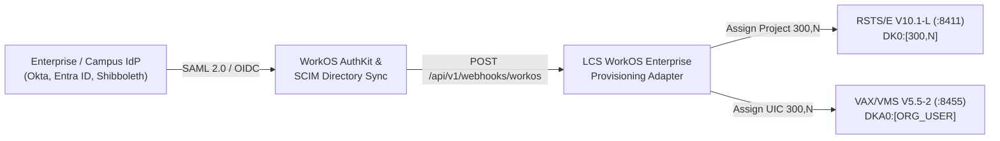

# Legacy Computing Systems — Monetization, Clerk Identity & Enterprise WorkOS Provisioning Plan

## 1. Executive Summary & Business Identity

- **Doing Business As (DBA)**: **Legacy Computing Systems** (*"Authentic DEC Timesharing & Workstation Computing in the Cloud"*)
- **Mission**: Provide retro-computing enthusiasts, software historians, universities, museums, and legacy industrial/aerospace maintainers with instant, zero-setup HTTPS browser and SSH access to authentic Digital Equipment Corporation (DEC) operating systems, compilers, and commercial/scientific application suites.
- **Core Product Offering**:
  - **PDP-11/70 RSTS/E V10.1-L Timesharing System** (`HTTPS :8411` / `SSH :2211`): 7 native PDP-11 compilers (`BASIC-PLUS-2`, `MACRO-11`, `COBOL-81`, `FORTRAN-77`, `DIBOL-83`, `RPG II`, `APL-11`) and 33 historical DEC & third-party applications (`WORD-11`, `20/20`, `TOTAL`, `MCBA`, `DIBS-11`, `MINITAB`, `SPSS-11`, etc.).
  - **VAXstation 4000-90 VAX/VMS V5.5-2 & DECwindows Motif Workstation** (`HTTPS :8455` / `SSH :2255`): Full 32-bit VAX/VMS DCL environment, live browser-rendered **DECwindows XUI / OSF/Motif 1.1 X11 GUI Workstation**, 10 native VAX compilers (`VAX BASIC`, `VAX MACRO`, `VAX FORTRAN`, `VAX COBOL`, `VAX C`, `VAX PASCAL`, `VAX PL/I`, `VAX ADA`, `VAX DIBOL`, `BLISS-32`), and 52 VAX/VMS applications (`WordPerfect 5.1`, `Lotus 1-2-3`, `Oracle V6`, `INGRES`, `SAS`, `SPICE3`, `ANSYS`, `Gaussian 90`, `ASK MANMAN`, `Cerner PathNet`, etc.).
- **Identity & Account Management Architecture**:
  1. **Primary B2C / Individual Subscriber Identity (`$10/mo` – `$15/mo`)**: Powered by **Clerk** + **Clerk Billing / Stripe** (free up to 10,000 MAUs), bridging modern web authentication (Email, Passkeys, GitHub/Google OAuth) and subscription billing to classic DEC terminal credentials (`$ACCT.SYS` on RSTS/E and `SYSUAF.DAT` on VAX/VMS).
  2. **Enterprise, University & Museum Site Licenses (`$199/mo` base w/ `15` active seats + `$10/mo` per additional active seat)**: Powered by **WorkOS (Enterprise SAML SSO & SCIM Directory Sync)** to automatically map corporate/campus identity providers (Okta, Microsoft Entra ID, Shibboleth) to dedicated RSTS/E Project Groups (`[300,*]`) and VAX/VMS UIC Groups (`[300,*]`), with automated active-seat metering.
  3. **Zero-Dependency Local Standalone Mode**: Automatically active when cloud API keys are omitted so the entire signup, checkout, and HTTPS account creation flow can be run, demonstrated, and tested locally or in Docker.

---

## 2. Subscription Tiers & Pricing Structure

| Plan Tier | Monthly Price | Target Audience & System(s) | Auth & Provisioned DEC Resources |
| :--- | :--- | :--- | :--- |
| **PDP-11 RSTS/E Timesharing** | **$10 / month** | Individual Subscriber<br>**RSTS/E V10.1-L** (`HTTPS :8411` / Funnel `:443`, `SSH :2211`) | • **Clerk Auth + Stripe Billing**<br>• Dedicated PPN `[201,xxx]` & username alias in `$ACCT.SYS` (`ACCT.JSON`)<br>• Private `DK0:[201,xxx]` directory (`25,000` blocks quota)<br>• DCL (`$`), BASIC-PLUS (`Ready`), and RSX (`>`) monitors + 7 compilers & 33 apps |
| **VAX/VMS & DECwindows Workstation** | **$10 / month** | Individual Subscriber<br>**VAX/VMS V5.5-2** (`HTTPS :8455` / Funnel `:8443`, `SSH :2255`) | • **Clerk Auth + Stripe Billing**<br>• Dedicated `SYSUAF` account & UIC `[200,xxx]` in `SYSUAF.DAT` (`SYSUAF.JSON`)<br>• Private ODS-2 `DKA0:[USERNAME]` directory (`50,000` blocks quota, `;version` support)<br>• VT220 Web Terminal + Live **DECwindows X11/Motif** GUI + 18 compilers & 52 apps |
| **DEC Dual-System Cluster Pass** | **$15 / month** | Power User / Historian<br>**Both RSTS/E + VAX/VMS** (`:8411` & `:8455`) | • **Clerk Auth + Stripe Billing**<br>• Simultaneous provisioning on **both** PDP-11 RSTS/E and VAX/VMS with matched credentials<br>• Expanded `100,000` blocks disk quota per system + priority batch/print queues |
| **Enterprise / University / Museum Site License** | **$199 / month base**<br>*(includes 15 active seats + $10/mo per additional active seat)* | Universities, Museums, Aerospace/Industrial Maintainers<br>**Both Systems (Multi-Seat)** | • **WorkOS Enterprise SAML SSO + SCIM Directory Sync** (Okta, Entra ID, Campus SSO)<br>• Dedicated RSTS/E Project Group `[300,*]` & VAX/VMS UIC Group `[300,*]`<br>• Automated seat provisioning, suspension (`DISUSER`), and active-seat metering (`GET /api/v1/enterprise/seats`) |

---

## 3. System Architecture: Clerk + HTTPS Access Point Provisioning Flow

Because modern identity providers (**Clerk** and **WorkOS**) never expose plaintext passwords (and OAuth/Passkey users do not have passwords), while classic DEC operating systems require a `1–12` character **DEC Username** and **DEC Terminal Password** for `User:` / `Username:`, `DECwindows X11`, and `SSH`, **Legacy Computing Systems** uses a two-layer bridge:

1. **Web Identity & Subscription Layer (Clerk)**: Authenticates the subscriber in the browser, manages the `$10/mo` subscription, and stores the user's assigned DEC account metadata (`dec_username`, `subscribed_os`, `ppn`, `uic`, `status`) in **Clerk `publicMetadata`**.
2. **DEC OS Provisioning Layer (HTTPS `:8411` & `:8455`)**: Creates and manages the native account inside [`OS/RSTS-E/src/rsts_os.py`](file:///home/ssadvisor/AGYprojects/DEC/OS/RSTS-E/src/rsts_os.py) (`ACCT.JSON` / `ACCT.SYS`) and [`OS/VMS/src/vms_os.py`](file:///home/ssadvisor/AGYprojects/DEC/OS/VMS/src/vms_os.py) (`SYSUAF.JSON` / `SYSUAF.DAT`).

```mermaid
sequenceDiagram
    autonumber
    actor User as Subscriber (Browser)
    participant Clerk as Clerk Identity & Billing<br/>(Web Auth + $10/mo Stripe Plan)
    participant Portal as Legacy Computing Systems<br/>Signup & Provisioning UI (/signup)
    participant RSTS as RSTS/E HTTPS Access Point<br/>(https://...:8411/api/v1/users)
    participant VMS as VAX/VMS HTTPS Access Point<br/>(https://...:8455/api/v1/users)

    User->>Clerk: 1. Sign Up / Sign In (Email, Passkey, GitHub/Google) & Select $10/mo Plan
    Clerk-->>Portal: 2. Issue Verified Session JWT + Subscription Active Claim
    User->>Portal: 3. Choose Target System (RSTS/E, VAX/VMS, or Both), DEC Username (e.g. JSMITH) & Terminal Password
    Portal->>Portal: 4. Verify Clerk JWT (or Local Standalone Token) & check username availability
    alt Selected OS == RSTS/E ($10/mo) or Bundle ($15/mo)
        Portal->>RSTS: 5a. POST /api/v1/users (HMAC-Signed JSON: username, password, clerk_user_id, email)
        RSTS->>RSTS: Allocate PPN [201,N], write DK0:[1,1]ACCT.JSON & ACCT.SYS, create fs/dk0/201_NNN/LOGIN.COM
        RSTS-->>Portal: 201 Created {ppn: "[201,1]", username: "JSMITH", terminal_url: "https://...:8411/"}
    end
    alt Selected OS == VAX/VMS ($10/mo) or Bundle ($15/mo)
        Portal->>VMS: 5b. POST /api/v1/users (HMAC-Signed JSON: username, password, clerk_user_id, email)
        VMS->>VMS: Add to SYSUAF.JSON & SYSUAF.DAT (UIC [200,N], DECW$USERS), create fs/dka0/jsmith/LOGIN.COM;1
        VMS-->>Portal: 201 Created {username: "JSMITH", uic: "[200,201]", terminal_url: "https://...:8455/"}
    end
    Portal->>Clerk: 6. Sync publicMetadata: {dec_username: "JSMITH", os: "VMS", uic: "[200,201]", ppn: "[201,1]"}
    Portal-->>User: 7. Display Provisioned Credentials Card (PPN/UIC) + One-Click Launch into HTTPS Terminal
```

---

## 4. Detailed Component Design

### 4.1. Clerk Account Management Integration (Primary B2C Flow)
- **Frontend Signup & Onboarding (`/signup`)**:
  - When `CLERK_PUBLISHABLE_KEY` is configured, `/signup` loads Clerk's JS SDK (`@clerk/clerk-js`) for drop-in registration, OAuth, email verification, and subscription management, then presents the **DEC System & Terminal Credential Provisioning Form**.
  - When `CLERK_PUBLISHABLE_KEY` is not set (Local Standalone / Docker Test Mode), `/signup` renders a unified self-contained **Legacy Computing Systems** form that collects email, `$10/mo` plan selection, DEC Username, and DEC Password in one step.
- **Clerk User Metadata Schema (`publicMetadata`)**:
  ```json
  {
    "dba": "Legacy Computing Systems",
    "plan": "LCS_VMS_10",
    "subscribed_os": ["VAX_VMS"],
    "dec_username": "JSMITH",
    "rsts_ppn": null,
    "vms_uic": "[200,201]",
    "account_status": "ACTIVE"
  }
  ```
- **Clerk & Stripe Webhook Handler (`POST /api/v1/webhooks/clerk`)**:
  - Listens for Clerk/Stripe lifecycle events signed with Svix/HMAC:
    - `user.deleted` or `subscription.canceled` / `invoice.payment_failed` $\rightarrow$ Automatically invokes `PATCH /api/v1/users/<dec_username>` with `{"status": "DISUSER"}` on RSTS/E and/or VAX/VMS.
    - `subscription.updated` / `invoice.paid` $\rightarrow$ Restores `NODISUSER` (`ACTIVE`) status and updates OS access if the user upgraded from a single `$10/mo` OS to the `$15/mo` Dual-System Bundle.

---

### 4.2. Optional WorkOS Enterprise SSO & SCIM Module (Phase 5 Expansion)
Adding an enterprise tier opens up three high-margin markets for **Legacy Computing Systems**:
1. **University Computer Science & Operating Systems Courses**: Professors teaching OS architecture, VAX MACRO, VMS DCL, COBOL, or FORTRAN can provision an entire class of 30–100 students in one click via campus SSO.
2. **Computer History Museums & Living Labs**: Interactive museum kiosks and member portals with managed visitor/member accounts.
3. **Industrial, Defense & Healthcare Legacy Maintenance**: Organizations maintaining legacy PDP-11 RSTS/E (`DIBOL`, `BASIC-PLUS-2`, `RMS-11`) or VAX/VMS (`VAX FORTRAN`, `VAX COBOL`, `Cerner PathNet`, `ASK MANMAN`) systems can train new engineers in an authentic sandboxed environment.



- **How the WorkOS Adapter Plugs In (`POST /api/v1/webhooks/workos`, `GET /auth/workos/callback`, & `GET /api/v1/enterprise/seats`)**:
  - **Organization-to-Group Mapping**: Each WorkOS `organization_id` is mapped to a dedicated **RSTS/E Project Number** (e.g., Project `300` $\rightarrow$ `[300,1]..[300,254]`) and a dedicated **VAX/VMS UIC Group** (e.g., Group `300` $\rightarrow$ `[300,1]..[300,254]`).
  - **Enterprise Seat Metering (`$199/mo` base + `$10/mo` per additional active seat)**:
    - Includes **`15` active seats** in the `$199/month` base fee.
    - Each active (`NODISUSER`) seat above `15` adds **`$10/month`** (`monthly_total = 199 + max(0, active_seats - 15) * 10`).
    - Suspended (`DISUSER`) accounts do not count toward active seat billing.
  - **Tailscale Funnel & OAuth Callback Alignment**:
    - RSTS/E (`:8411` local $\rightarrow$ Funnel `:443`): `https://ssadvisor-ser.tail8d2674.ts.net/auth/workos/callback`
    - VAX/VMS (`:8455` local $\rightarrow$ Funnel `:8443`): `https://ssadvisor-ser.tail8d2674.ts.net:8443/auth/workos/callback`
  - **SCIM Automated Provisioning**:
    - `dsync.user.created` $\rightarrow$ Automatically generates a `1–12` char DEC username from the employee/student email, creates `[300,N]` in RSTS/E and/or VAX/VMS, updates active seat metering, and emails/displays their temporary terminal password.
    - `dsync.user.deleted` / `dsync.user.suspended` $\rightarrow$ Immediately sets `DISUSER` on their RSTS/E and VAX/VMS accounts and decrements the organization's active seat count.

---

### 4.3. HTTPS Access Point Provisioning APIs (`:8411` & `:8455`)

Both [`OS/RSTS-E/src/multiuser_service.py`](file:///home/ssadvisor/AGYprojects/DEC/OS/RSTS-E/src/multiuser_service.py) and [`OS/VMS/src/multiuser_service.py`](file:///home/ssadvisor/AGYprojects/DEC/OS/VMS/src/multiuser_service.py) will expose a unified set of endpoints over their existing HTTPS servers (`8411` and `8455`):

| HTTP Method & Path | Description | Auth Mechanism |
| :--- | :--- | :--- |
| `GET /signup` | Serves the **Legacy Computing Systems** signup & account provisioning portal (Clerk-enabled or Standalone) | Public (HTTPS) |
| `GET /api/v1/users/check?username=<NAME>` | Checks real-time availability of `<NAME>` (`1–12` alphanumeric chars) across `$ACCT.SYS` / `SYSUAF.DAT` | Public |
| `POST /api/v1/signup` | Validates Clerk JWT / `$10/mo` subscription token (or Demo Checkout) and provisions the user on RSTS/E, VAX/VMS, or Both | Clerk JWT / Payment Token |
| `POST /api/v1/users` | Direct programmatic account creation (allocates PPN `[201,N]` or UIC `[200,N]` + home directory & `LOGIN.COM`) | `X-LCS-Signature` (HMAC-SHA256) |
| `PATCH /api/v1/users/<username>` | Updates account status (`ACTIVE` / `DISUSER`), quota, or rotates terminal password | `X-LCS-Signature` or Clerk JWT |
| `POST /api/v1/webhooks/clerk` | Processes Clerk & Stripe subscription lifecycle webhooks (`user.deleted`, `subscription.canceled`, `invoice.paid`) | Clerk/Svix Webhook Secret |
| `POST /api/v1/webhooks/workos` | *(Optional Enterprise Hook)* Processes WorkOS SCIM directory sync events (`dsync.user.created`, `dsync.user.deleted`) | WorkOS Webhook Secret |
| `POST /api/v1/coupons` | Generates a **6-digit random discount coupon code** (`000000`–`999999`) with percentage discount up to **100ths place** (`0.01%`–`100.00%`) and expiration of `never`, `days` (`1..365`), or `months` (`1..12`, max 1 year) | Admin / `X-LCS-Signature` |
| `GET /api/v1/coupons` | Lists active and expired promotional discount coupons stored on the node | Public / Admin |
| `GET /api/v1/coupons/validate?code=<6-DIGIT>&plan=<PLAN>` | Validates a 6-digit coupon code, checks expiration, and computes `discount_amount_usd` & `discounted_price_usd` to the 100ths place (`$0.01`) | Public |
| `GET /api/v1/enterprise/seats` | Returns real-time active enterprise seat counts and `$199/mo + $10/seat` billing breakdown per WorkOS organization | Public / Admin |
| `GET /api/v1/status` | Returns OS node status, active terminal count, Funnel callback URL, and provisioning health | Public |

---

### 4.3.1. Promotional Discount Coupon System (`6-Digit Random Code` & `100ths Percentage Precision`)
- **Code Format**: Every generated coupon code is a cryptographically random **6-digit numeric string** (`000000`–`999999`), automatically checked for collisions and synchronized across both `dec-rsts-e` (`:8411`) and `dec-vms` (`:8455`).
- **Percentage Discount Precision**: Expressed in percentages (`> 0%` up to `100.00%`). All percentage amounts up to the **fractional 100ths place** (`0.01%`, e.g., `12.75%`, `33.33%`, `50%`, `100.00%`) are valid; values with finer precision (e.g., `12.345%`) or out of range (`<= 0%` or `> 100%`) are rejected with `400 Bad Request`.
- **Coupon Age / Expiration Policy**:
  - `duration_unit: "never"` — Non-expiring coupon (`never_expires: true`, `expires_at: null`).
  - `duration_unit: "days"` — Expires after `duration_value` days (`1 <= duration_value <= 365`).
  - `duration_unit: "months"` — Expires after `duration_value` months (`1 <= duration_value <= 12`).
  - **1-Year Maximum Age Enforcement**: Any expiring coupon with a duration exceeding **1 year** (`> 365` days or `> 12` months) is rejected with `400 Bad Request`.

---

### 4.4. Account Creation Mechanics per Operating System

#### A. PDP-11 RSTS/E V10.1-L (`https://localhost:8411`)
When a user selects **RSTS/E (`$10/mo`)** or **Bundle (`$15/mo`)**:
1. **Allocates Next Unprivileged PPN**: Scans Project `201` (`[201,1]`..`[201,254]`) in `DK0:[1,1]ACCT.JSON` (or Project `300+` for WorkOS Enterprise organizations).
2. **Persists Account to `ACCT.JSON` & `ACCT.SYS`**:
   - Sets `priv: False` (`NOPRIV`), `quota: 25000`, `status: "ACTIVE"`, `clerk_user_id`, and `email`.
3. **Supports Both PPN and Username Login at `User:` Prompt**:
   - Enhances [`OS/RSTS-E/src/rsts_os.py`](file:///home/ssadvisor/AGYprojects/DEC/OS/RSTS-E/src/rsts_os.py) so the subscriber can log in at `User:` using **either** their assigned PPN (`201,1`) **or** their chosen username (`JSMITH`).
4. **Creates Private Home Directory (`DK0:[201,N]`)**:
   - Creates `OS/RSTS-E/fs/dk0/201_NNN/` with a personalized `LOGIN.COM`, `WELCOME.TXT`, and `HELLO.BAS`.

#### B. VAX/VMS V5.5-2 (`https://localhost:8455`)
When a user selects **VAX/VMS (`$10/mo`)** or **Bundle (`$15/mo`)**:
1. **Allocates Next SYSUAF UIC**: Scans Group `200` (`[200,201]`..`[200,999]`) in `DKA0:[SYS0.SYSCOMMON.SYSEXE]SYSUAF.JSON` (or Group `300+` for WorkOS Enterprise organizations).
2. **Persists Account to `SYSUAF.JSON` & `SYSUAF.DAT`**:
   - Sets `privs: "TMPMBX,NETMBX"`, `flags: "NODISUSER"`, `identifiers: ["DECW$USERS", "LCS$SUBSCRIBER"]`, `quota: 50000`, `clerk_user_id`, and `email`.
3. **Creates ODS-2 Home Directory (`DKA0:[USERNAME]`)**:
   - Creates `OS/VMS/fs/dka0/<username>/` with `LOGIN.COM;1`, `WELCOME.TXT;1`, and `HELLO.BAS;1`.
4. **Enables Instant VT220 & Live DECwindows X11 Login**:
   - Immediately active at both the VT220 `Username:` prompt and the graphical **DECwindows OSF/Motif 1.1 Start Session** dialog (`/ws-x11`).

---

## 5. Phased Implementation Roadmap

### Phase 1: OS Account Provisioning Engines & Login Enhancements
- Update [`OS/RSTS-E/src/rsts_os.py`](file:///home/ssadvisor/AGYprojects/DEC/OS/RSTS-E/src/rsts_os.py):
  - Add `provision_subscriber_account(...)` and `update_subscriber_account(...)` methods.
  - Allow `User:` login by **Username** (e.g., `JSMITH`) in addition to PPN (`201,1`), and enforce `DISUSER` account suspension.
- Update [`OS/VMS/src/vms_os.py`](file:///home/ssadvisor/AGYprojects/DEC/OS/VMS/src/vms_os.py):
  - Add `provision_subscriber_account(...)` and `update_subscriber_account(...)` methods updating `SYSUAF.JSON` & `SYSUAF.DAT` and scaffolding `DKA0:[USERNAME]`.

### Phase 2: Shared "Legacy Computing Systems" Signup Portal, Clerk Bridge & WorkOS Stub
- Create the **Legacy Computing Systems** signup & provisioning module (`GET /signup`, `POST /api/v1/signup`, `GET /api/v1/users/check`, `POST /api/v1/users`, `PATCH /api/v1/users/<username>`, `POST /api/v1/webhooks/clerk`, `POST /api/v1/webhooks/workos`) integrated into [`OS/RSTS-E/src/multiuser_service.py`](file:///home/ssadvisor/AGYprojects/DEC/OS/RSTS-E/src/multiuser_service.py) (`:8411`) and [`OS/VMS/src/multiuser_service.py`](file:///home/ssadvisor/AGYprojects/DEC/OS/VMS/src/multiuser_service.py) (`:8455`).
- Support cross-node provisioning (signing up on `:8411/signup` or `:8455/signup` can create an account on RSTS/E, VAX/VMS, or both).
- Add a **`SIGN UP ($10/MO)`** button to the top bar of both HTTPS web terminals.

### Phase 3: End-to-End Automated Test Suite & Docker Verification
- Add automated pytest suites in [`OS/RSTS-E/tests/test_rsts_e.py`](file:///home/ssadvisor/AGYprojects/DEC/OS/RSTS-E/tests/test_rsts_e.py) and [`OS/VMS/tests/test_vms.py`](file:///home/ssadvisor/AGYprojects/DEC/OS/VMS/tests/test_vms.py) verifying:
  1. `GET /signup` renders the **Legacy Computing Systems** `$10/mo` signup form with Clerk & Enterprise WorkOS hooks.
  2. `POST /api/v1/signup` provisions a new RSTS/E subscriber (`[201,1]`) and VAX/VMS subscriber (`[200,201]`), creates their home directories and `LOGIN.COM`, and allows immediate login by username and password.
  3. Clerk (`POST /api/v1/webhooks/clerk`) and WorkOS (`POST /api/v1/webhooks/workos`) webhook handlers automatically provision and suspend (`DISUSER`) accounts.
